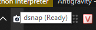

# GitHub Issues Roadmap for datlp/dsnap 🚀

This document tracks the technical specifications, architectural designs, and progress of the core issues in `datlp/dsnap`, aligned with standard open-source conventions.

---

## Issue #1: [Core] Initial Win32 native architecture and FFmpeg controller

**Labels:** `enhancement`, `core`, `win32`

### Description
Implement the core architecture of `dsnap`: an ultra-lightweight (< 400 KB) native screen capture and recording utility written in pure C++ Win32 API with zero external runtime dependencies.

### Tasks
- [x] Register global keyboard hooks via Low-Level Keyboard Hook (`WH_KEYBOARD_LL`) for `PrintScreen` and `Shift + PrintScreen`.
- [x] Implement semi-transparent selection overlay window (`WS_EX_LAYERED`).
- [x] Integrate GDI `BitBlt` snapshotting and GDI+ PNG Encoder to save images into `Pictures\Screenshots` and copy to Clipboard (`CF_BITMAP`).
- [x] Automatically discover `ffmpeg.exe` in local directory or system `PATH`.
- [x] Launch background FFmpeg process via Anonymous Pipes, sending graceful `'q'` command to finalize MP4 containers.
- [x] Enable Per-Monitor DPI Awareness V2 and full virtual screen spanning.

**Commit:** `feat: initial Win32 native implementation of dsnap (#1)`

---

## Issue #2: [UI] Add high-contrast dual-mode icon for Dark & Light taskbars

**Labels:** `ui`, `enhancement`, `design`

### Description
The application icon in the system tray was difficult to see on contrasting Windows Taskbar color themes (e.g. pure dark vs. bright light mode).

### Solution
- Create a multi-resolution `dsnap.ico` file containing 7 standard sizes (`16x16`, `24x24`, `32x32`, `48x48`, `64x64`, `128x128`, `256x256`).
- Render camera viewfinder silhouette with an electric blue accent that pops brightly on dark themes.
- Add dual-contrast stroke and drop-shadow to guarantee sharp 100% visibility on light themes.
- Pixel-hint the small 16x16 icon for tray clarity.
- Embed resources via `res/dsnap.rc` (`IDI_APPICON 101`).

**Commit:** `feat(ui): add high-contrast dual-mode pixel-crafted icon (#2)`

---

## Issue #3: [Overlay] Fix stacking overlay transparency and nested message loops

**Labels:** `bug`, `ui`, `performance`

### Description
Pressing `PrintScreen` multiple times in rapid succession caused overlapping translucent windows to make the screen darker and induced application freezing.

### Root Cause
- Missing state guard for active overlay (`g_isOverlayActive`).
- Each keypress spawned a new `WS_EX_LAYERED` window with stacked alpha opacity ($1 - (1 - 0.24)^n$).
- Each overlay spawned a nested `while (GetMessage)` loop breaking message flow.

### Solution
- Register `DsnapOverlay` window class once at application startup.
- Unify event dispatching into a single centralized message loop in `WinMain`.
- Add `g_isOverlayActive` guard to ignore duplicate triggers while selection is active.

**Commit:** `fix: prevent duplicate overlay stacking and eliminate nested message loops (#3)`

---

## Issue #4: [Capture] Implement Freeze Desktop Snapshot to capture context menus

**Labels:** `bug`, `core`, `ux`

### Description
Right-clicking the system tray or open menus and pressing `PrintScreen` caused menus to dismiss immediately before they could be captured.

### Root Cause
- Windows Shell (`explorer.exe`) claims exclusive mouse capture via `SetCapture()` while menus are open.
- When an overlay window activates, the focus change triggers Windows to dismiss the popup menu in under 1ms.

### Solution
- Switch to a **Freeze Desktop Snapshot** architecture:
  1. Instantly blit the full virtual desktop to RAM via `BitBlt` within 2ms before Windows dismisses menus.
  2. Release mouse capture (`EndMenu`).
  3. Render the frozen snapshot and display real-time spotlight illumination with double-buffering at 60+ FPS.
  4. Provide direct capture and record options in the system tray context menu.

**Commit:** `fix: implement Freeze Desktop Snapshot to capture system tray and context menus (#4)`

---

## Issue #5: [Recorder] Add non-intrusive region border and floating control toolbar

**Labels:** `enhancement`, `recorder`, `ui`

### Description
During screen recording, users had no visual indicator of the active recording boundary and lacked mouse controls to pause or stop recording.

### Solution
- **Highlight Border around Recording Area:**
  - 3px perimeter border with `WS_EX_TRANSPARENT` for 100% mouse click-through.
  - Excluded from video stream via `SetWindowDisplayAffinity(WDA_EXCLUDEFROMCAPTURE)`.
- **Top-Right Floating Recording Toolbar:**
  - Real-time elapsed timer `● MM:SS`.
  - `⏸ / ▶` (Pause / Resume) via low-level `NtSuspendProcess` / `NtResumeProcess`.
  - `⏹` (Stop & Save): Finalizes MP4 recording cleanly.
  - `✕` (Cancel): Instantly terminates and deletes temporary video file.

**Commit:** `feat(recorder): add click-through region border and top-right floating toolbar (#5)`

---

## Issue #6: [Audio] Add optional DirectShow audio recording toggle

**Labels:** `enhancement`, `audio`, `recorder`

### Description
Users requested optional audio recording capability (Microphone or Stereo Mix) during screen capture, defaulting to off for minimal file sizes.

### Solution
- Automatically enumerate available audio input devices via DirectShow `CLSID_AudioInputDeviceCategory`.
- Add toggle menu item in system tray: `[ ] 🎙️ Record Audio` (defaults to disabled).
- Append AAC audio stream arguments (`-c:a aac -b:a 128k`) when enabled.
- Persist setting in Windows Registry (`HKCU\Software\dsnap\RecordAudio`).

**Commit:** `feat(audio): add optional audio recording toggle in tray menu (#6)`

---

## Issue #7: [App] Enforce strict single-instance lifecycle with Global Mutex

**Labels:** `enhancement`, `stability`, `win32`

### Description
Prevent users from launching multiple instances of `dsnap.exe`, which created conflicting keyboard hooks and duplicate tray icons.

### Solution
- **Two-Layer Protection:**
  - Probe background window with `FindWindowW(BG_CLASS, L"dsnap_bg")`. If present, wake running instance and exit immediately.
  - Named Mutex: `Global\Dsnap_SingleInstance_Mutex_9999` across all user sessions.
- **User Feedback:** Running instance displays a balloon tip: *"dsnap is already running in the system tray!"*.
- **Explorer Crash Recovery:** Handles `RegisterWindowMessageW(L"TaskbarCreated")` to re-register tray icon if Windows Explorer restarts.

**Commit:** `fix: enforce single-instance lifecycle using Global Mutex and FindWindow (#7)`

---

## Issue #8: [Recorder] Add auto-download prompt and background installer for FFmpeg

**Labels:** `enhancement`, `recorder`, `ux`
**Status:** `Closed (v1.0.1)`

### Description
Screen recording requires FFmpeg, but users may not have `ffmpeg.exe` installed on their machine or configured in system `PATH`.

### Solution
- Provide a 1-click confirmation dialog `[Yes] [No]` prompting the user to install FFmpeg automatically.
- Download portable FFmpeg release mirror (~84 MB) via `URLDownloadToFileW` (`urlmon.dll`) on a background thread.
- Extract archive directly into application directory via Windows native `tar.exe` (`tar -xf <zip> -C <dest>`) with zero external dependencies.
- Update system tray tooltip and display native Windows balloon notifications during and upon completion.

**Commit:** `feat(recorder): add auto-download prompt for FFmpeg and bump to v1.0.1 (#8)`

---

## Issue #9: [UI] Show shortcut hotkey hints in tray tooltip and capture overlay

**Labels:** `enhancement`, `ui`, `ux`
**Status:** `Closed (v1.0.2)`

### Description
Currently, hovering the cursor over the system tray icon displays only a static tooltip: `dsnap (Ready)`.



New users often forget the global hotkeys to trigger screenshot capture or screen recording and must right-click the tray menu to check.

### Proposed Solution
1. **Multi-line / Detailed System Tray Tooltip (`szTip`):**
   Update `NOTIFYICONDATAW.szTip` to show clear hotkey hints:
   ```text
   dsnap
   • Capture: PrtScn
   • Record: Shift + PrtScn
   ```
   *(Note: Win32 `NOTIFYICONDATAW` supports multi-line tooltips up to 128 characters when using Shell32 V5 / `NOTIFYICON_VERSION_4`)*.
2. **On-Screen Selection Hint:**
   Display a subtle floating tip HUD near the selection cursor or at top-center during overlay mode:
   - Photo mode: *"Drag to select • Enter / Double-click to copy & save • Esc to cancel"*
   - Video mode: *"Drag to select recording region • Esc to cancel"*

**Commit:** `feat(ui): add multi-line tray hotkey hints and overlay floating HUD (#9)`

---

## Issue #10: [Installer] Implement dual-mode Inno Setup installer (All-Users vs. Per-User)

**Labels:** `installer`, `enhancement`, `windows`
**Status:** `Closed (v1.0.2)`

### Description
Provide a modern Windows setup wizard inspired by AutoHotkey's distribution model that accommodates both enterprise environments (system-wide `C:\Program Files`) and standard user accounts without administrator privileges (`%LocalAppData%\Programs`).

### Solution
- Create `installer/dsnap.iss` using Inno Setup 6/7.
- Enable `PrivilegesRequiredOverridesAllowed=dialog` to prompt the user during installation:
  - **All Users (Admin):** Target `{autopf}\dsnap` (`C:\Program Files\dsnap`) with UAC elevation.
  - **Current User (Standard):** Target `{userappdata}\Programs\dsnap` with zero UAC elevation.
- Add optional tasks: Desktop shortcut creation and Windows startup autostart.
- Register uninstaller cleanly in Windows Settings (`Apps & Features`) with application icon, publisher, and version.
- Support silent automation switches (`/VERYSILENT`, `/ALLUSERS`, `/CURRENTUSER`) for package managers.

**Commit:** `ci: build installer and publish versioned release assets with SHA256SUMS on tag (#10, #12, #14)`

---

## Issue #11: [Core] Add Portable Mode with local configuration (`dsnap.ini`)

**Labels:** `core`, `portability`, `enhancement`
**Status:** `Closed (v1.0.2)`

### Description
Ensure `dsnap` can run fully self-contained from a USB drive or arbitrary folder without leaving traces in the Windows Registry.

### Solution
- Check for `dsnap.ini` in application directory on startup, or `--portable` command-line flag.
- When portable mode is active, read/write configuration (`RecordAudio`, autostart, hotkeys) to local `dsnap.ini` via Win32 `GetPrivateProfileStringW` / `WritePrivateProfileStringW`.
- Maintain 100% zero-footprint portable execution when running from `dsnap-windows-x64.zip`.

**Commit:** `feat(core): add portable mode with local dsnap.ini configuration (#11)`

---

## Issue #12: [CI/CD] Automate installer packaging in build scripts and GitHub Releases

**Labels:** `ci`, `automation`, `devops`
**Status:** `Closed (v1.0.2)`

### Description
Standardize the release distribution pipeline across local development and GitHub Actions.

### Solution
- Add `build.bat installer` target that invokes `iscc.exe installer\dsnap.iss`.
- Update GitHub Actions workflow to compile and upload standard release assets on tag push:
  1. `dsnap-v<version>-setup.exe` (Universal Inno Setup Installer)
  2. `dsnap-v<version>-windows-x64.exe` (Versioned standalone portable)
  3. `dsnap-v<version>-windows-x64.zip` (Portable ZIP package)
  4. `dsnap.exe` (Static standalone for permalinks & Winget CLI)
  5. `SHA256SUMS.txt`

**Commit:** `ci: build installer and publish versioned release assets with SHA256SUMS on tag (#10, #12, #14)`

---

## Issue #13: [Distribution] Publish dsnap to Windows Package Manager (Winget)

**Labels:** `distribution`, `winget`, `deployment`
**Status:** `Open (Planned)`

### Description
Allow users to install and update `dsnap` via `winget install datlp.dsnap`.

### Solution
- Generate `microsoft/winget-pkgs` manifest using `wingetcreate`.
- Configure manifest to consume `dsnap-v<version>-setup.exe` with silent install flags `/VERYSILENT /SUPPRESSMSGBOXES /NORESTART`.

---

## Issue #14: [Release] Publish versioned installer and consistent versioned asset names

**Labels:** `release`, `enhancement`
**Status:** `Closed (v1.0.2)`

### Description
Standardize asset naming across all releases to follow the `<name>-v<version>-<variant>.<ext>` pattern (similar to `ytmusic-morphe-v9.30.53.apk`) and include the compiled Inno Setup installer.

### Solution
- Version dynamically passed into Inno Setup via `/DMyAppVersion=<ver>`.
- Workflow validates `dsnap.exe` internal file version matches tag name before releasing.
- Assets published for each release:
  - `dsnap-v<version>-setup.exe` (Inno Setup)
  - `dsnap-v<version>-windows-x64.exe`
  - `dsnap-v<version>-windows-x64.zip`
  - `dsnap.exe` (permalink)
  - `SHA256SUMS.txt`

**Commit:** `ci: build installer and publish versioned release assets with SHA256SUMS on tag (#10, #12, #14)`

---

## Issue #15: [Build] Embed version info (VERSIONINFO) in dsnap.exe

**Labels:** `build`, `enhancement`
**Status:** `Closed (v1.0.2)`

### Description
Windows Explorer Properties > Details was empty. Adding a `VERSIONINFO` resource establishes publisher metadata and binary versioning for SmartScreen and Antivirus reputation.

### Solution
- Define version macros centrally in `res/version.h` (`DSNAP_VERSION_MAJOR`, `MINOR`, `PATCH`, `STR`, `RC`).
- Add standard `VS_VERSION_INFO VERSIONINFO` block in `res/dsnap.rc` specifying `CompanyName`, `FileDescription`, `FileVersion`, `ProductVersion`, and `LegalCopyright`.

**Commit:** `feat(build): embed VERSIONINFO resource in dsnap.exe (#15)`

---

## Issue #16: [FX] Visual mouse click effects and ripple animations for screencasting

**Labels:** `enhancement`, `ui`, `recording`
**Status:** `Closed (v1.1.0-dev)`

### Description
During screen recording, presentations, and tutorials, viewers cannot distinguish between left-clicks, right-clicks, or cursor movement. Standard screen recording tools (Camtasia, ScreenToGif) provide click highlight rings, but they are heavy commercial software.

### Functional Requirements
- **Left-Click Ripple:** Expanding, decaying ring centered at cursor position (Accent Cyan `#00E5FF`, radius 8px -> 36px, ~250ms).
- **Right-Click Ripple:** Expanding, decaying ring with distinctive hue (Accent Coral/Red `#FF4500`, radius 8px -> 32px, ~250ms).
- **Tray Context Menu Toggle:** Add `[v] Highlight Mouse Clicks` to enable/disable.
- **Persistence:** Save setting in `dsnap.ini` (Portable) and Windows Registry (`HighlightClicks=1`).

### Technical Architecture (Win32 C++17)
- Dynamic Low-Level Mouse Hook (`WH_MOUSE_LL`) attached only when the feature is active (0% CPU when idle/disabled).
- Layered transparent click-through window (`WS_EX_LAYERED | WS_EX_TRANSPARENT | WS_EX_NOACTIVATE`).
- Hardware/GDI+ 32-bit ARGB double-buffered rendering at 60 FPS (< 0.2% CPU).

**Commit:** `feat: implement visual mouse click ripple effects and multi-language i18n (#16, #17)`

---

## Issue #17: [i18n] Multi-language localization (English, Vietnamese, Chinese, Korean, Japanese)

**Labels:** `enhancement`, `i18n`, `ui`
**Status:** `Closed (v1.1.0)`

### Description
`dsnap` is currently English-only. To provide a seamless localized experience for users globally and across Asia, the application should support the 5 major languages with zero external dependencies.

### Supported Locales
1. **English (`en-US`)** - Default
2. **Vietnamese (`vi-VN`)** - Tiếng Việt
3. **Simplified Chinese (`zh-CN`)** - 简体中文
4. **Korean (`ko-KR`)** - 한국어
5. **Japanese (`ja-JP`)** - 日本語

### Functional Requirements
- **Auto-Detection:** Automatically detect Windows system UI locale via `GetUserDefaultUILanguage()` on initial startup.
- **Tray Context Submenu:** Dedicated `Language` submenu for instant manual switching without restarting the app.
- **Persistence:** Save selected language in `dsnap.ini` (Portable) and Windows Registry (`Language=vi-VN`).
- **Scope of Localized Strings:**
  - Tray Context Menu items
  - Tray Hover Tooltip (`szTip`)
  - Overlay HUD guidance text
  - Dialog prompts (FFmpeg auto-download confirm)
- **Installer Integration:** Add multilingual support to Inno Setup installer script (`installer/dsnap.iss`).

### Technical Architecture
- Lightweight static `constexpr` string lookup table in `src/i18n.h` and `src/i18n.cpp`.
- Zero third-party dependencies (no ICU, no gettext).
- Executable size impact < 12 KB.

**Commit:** `feat: implement visual mouse click ripple effects and multi-language i18n (#16, #17)`

---

## Issue #18: [Core/UIPI] Implement Hybrid Hotkey Engine (RegisterHotKey + WH_KEYBOARD_LL) to capture over elevated windows

**Labels:** `bug`, `core`, `hotkey`, `uipi`, `windows`
**Status:** `Closed (v1.1.0)`

### Description
When user focus is on an elevated window (running with Administrator rights such as CrystalDiskInfo, Task Manager, Registry Editor, or elevated PowerShell), pressing `PrintScreen` or `Shift + PrintScreen` did not trigger `dsnap`.

### Root Cause
Under Windows User Interface Privilege Isolation (UIPI), low-level keyboard hooks (`WH_KEYBOARD_LL`) installed by Medium Integrity processes are dropped by Windows when an elevated (High Integrity) window receives keyboard focus to prevent untrusted keylogging.

### Architectural Solution
- **Hybrid Dual-Engine Architecture:**
  1. **Primary Kernel Hotkey:** Register `RegisterHotKey(g_hMainWnd, HOTKEY_ID_PHOTO, 0, VK_SNAPSHOT)` and `RegisterHotKey(g_hMainWnd, HOTKEY_ID_VIDEO, MOD_SHIFT, VK_SNAPSHOT)`. Because this is managed directly in Windows kernel (`win32k.sys`), `WM_HOTKEY` messages bypass UIPI and are dispatched to `dsnap` even when elevated Administrator windows are focused.
  2. **Fallback Low-Level Hook:** Maintain `WH_KEYBOARD_LL` as an active fallback in case `RegisterHotKey` is claimed by the Windows 11 Snipping Tool.
  3. **Event De-duplication:** 250ms timestamp debounce guard (`TriggerActionDebounced`) ensures single activation if both engines receive the keystroke.

**Commit:** `feat: implement hybrid hotkey engine to bypass UIPI and bump to v1.1.0 (#18)`

---

## Issue #19: [Core/Elevation] Implement Task Scheduler XML engine and CLI switches for zero-UAC elevated autostart

**Labels:** `enhancement`, `core`, `security`, `windows`
**Status:** `Closed (v1.1.2)`

### Description
When a user configures `dsnap` to run with Administrator privileges (`RUNASADMIN`), standard Windows autostart via `HKCU\Software\Microsoft\Windows\CurrentVersion\Run` is silently blocked by Windows Shell at logon. Additionally, basic `schtasks /Create /SC ONLOGON` tasks default to blocking execution on laptop battery power (`DisallowStartIfOnBatteries`) and terminating after 72 hours (`ExecutionTimeLimit`).

### Architectural Solution
- **Task Scheduler XML 1.2 Engine (`src/config.cpp`):**
  - Generate Task Scheduler XML with `<RunLevel>HighestAvailable</RunLevel>`, `<LogonType>InteractiveToken</LogonType>`, `<DisallowStartIfOnBatteries>false</DisallowStartIfOnBatteries>`, `<StopIfGoingOnBatteries>false</StopIfGoingOnBatteries>`, and `<ExecutionTimeLimit>PT0S</ExecutionTimeLimit>`.
  - Register `dsnap_Autostart` silently (`CREATE_NO_WINDOW`) and store `AutoStartTask=1` in `HKCU\Software\dsnap` for instant 0.01ms tray menu state queries.
- **One-Shot CLI Switches (`src/main.cpp`):**
  - Handle `--register-admin-task` and `--unregister-admin-task` prior to the Single-Instance Mutex check for seamless invocation by the installer or elevated helper processes.
- **Tray Menu Synchronization:**
  - Refactor `IsAutoStartEnabled()` and `SetAutoStart(bool)` to automatically switch between Registry `Run` and Task Scheduler depending on elevation configuration.

**Commit:** `feat(installer,core): add Run as Administrator setup task and zero-UAC Task Scheduler autostart (#19, #21)`

---

## Issue #20: [i18n/Build] Fix UTF-8 source encoding mojibake in MSVC compiler and refine tray menu typography

**Labels:** `bug`, `i18n`, `ui`, `build`
**Status:** `Closed (v1.1.1)`

### Description
When running `dsnap`, context menu and submenu strings were corrupted into ANSI mojibake characters (`Tiếng Việt`, `简体中文`, `ðŸ"`).

### Root Cause
MSVC (`cl.exe`) in CI defaults to the host machine's ANSI code page (Windows-1252 / CP1252) when compiling source files lacking a UTF-8 BOM and without the `/utf-8` compiler flag. Multi-byte UTF-8 sequences were misparsed as single CP1252 bytes before being widened to `wchar_t` (`L"..."`).

### Architectural Solution
- Added `/utf-8` compiler flag to MSVC invocations in CI workflow (`build.yml`) and `build.bat`.
- Re-encoded internationalized source files (`src/i18n.cpp`, `src/tray.cpp`, `src/overlay.cpp`) with explicit UTF-8 BOM.
- Polished tray menu typography across English, Vietnamese, Simplified Chinese, Korean, and Japanese to use native clean text without surrogate-pair emoji glitches.

**Commit:** `fix(i18n): resolve UTF-8 mojibake with /utf-8 compiler flag and bump to v1.1.1 (#20)`

---

## Issue #21: [Installer] Add 'Always run dsnap as Administrator' task option in Inno Setup wizard

**Labels:** `installer`, `enhancement`, `security`, `ux`
**Status:** `Closed (v1.1.2)`

### Description
Provide a direct checkbox option in the Inno Setup installation wizard (`Select Additional Tasks` page) allowing users to configure `dsnap` to always run with full Administrator privileges (`RUNASADMIN`) without manually editing executable properties after installation.

### Architectural Solution
- **Wizard Task Checkbox (`installer/dsnap.iss`):**
  - Add `runasadmin` task: `"Always run dsnap as Administrator (Full privileges for elevated apps & games)"` (unchecked by default).
- **Windows Compatibility Layer (`AppCompatFlags\Layers`):**
  - When selected, write `~ RUNASADMIN` for `{app}\dsnap.exe` under `HKA\Software\Microsoft\Windows NT\CurrentVersion\AppCompatFlags\Layers`.
  - Automatically clean up the flag if unchecked on reinstall or during uninstallation.
- **Smart Autostart Hand-off (`CurStepChanged`):**
  - When both `autostart` and `runasadmin` are selected, remove standard `HKCU\...\Run` entry and invoke `dsnap.exe --register-admin-task` to register zero-UAC elevated logon startup via Windows Task Scheduler.
  - Add `shellexec` flag to `[Run]` postinstall entry so `dsnap.exe` launches with Administrator rights immediately after setup.
  - Remove `dsnap_Autostart` scheduled task in `InitializeUninstall()`.

**Commit:** `feat(installer,core): add Run as Administrator setup task and zero-UAC Task Scheduler autostart (#19, #21)`

---

## Issue #22: [Audio/Mixer] Implement Multi-Device WASAPI Loopback + Microphone Audio Mixer and Device Selector Submenu

**Labels:** `enhancement`, `audio`, `ui`, `core`
**Milestone:** `v1.2.0 - Multi-Device Audio Mixer & UX`
**Status:** `Closed (v1.2.0)`

### Description
Modern Windows setups frequently involve multiple active audio endpoints simultaneously (e.g., Desktop Speakers + USB/Bluetooth Headphones, or Built-in Mic + Headset Mic + Webcam Mic). Previously, `dsnap` only captured the single default `eRender` output endpoint in loopback mode and did not support microphone input or multi-endpoint selection.

### Architectural Solution
- **Tray Context Menu (Option B - `src/tray.cpp`, `res/resource.h`):**
  - Retained quick main menu checkboxes: `[✓] Record System Audio` (`IDM_TOGGLE_AUDIO`) and `[✓] Record Microphone` (`IDM_TOGGLE_MIC`).
  - Added dynamic `Audio Devices >` submenu enumerating active `eRender` (Output) and `eCapture` (Input) endpoints on menu open using `IMMDeviceEnumerator::EnumAudioEndpoints` and `PKEY_Device_FriendlyName`.
  - Supports choosing `Default System Output` / `Default Microphone` or multi-selecting any combination of specific Speakers, Headphones, and Microphones simultaneously.
- **Multi-Stream WASAPI Auto-Convert & QPC Real-Time Mixer (`src/audio.h`, `src/audio.cpp`):**
  - Initializes each selected `IAudioClient` in `AUDCLNT_SHAREMODE_SHARED` with `AUDCLNT_STREAMFLAGS_AUTOCONVERTPCM | AUDCLNT_STREAMFLAGS_SRC_DEFAULT_QUALITY` at a unified target format of **48,000 Hz, 2-channel Stereo, 32-bit IEEE Float** (`f32le`), with automatic mono-to-stereo upmix fallback.
  - Uses a `QueryPerformanceCounter` (QPC) hardware wall-clock pacer (10ms = 480 stereo frames) with per-stream FIFO buffers and `[-1.0f, 1.0f]` soft-clipping to mix all active output and microphone streams into a single continuous pipe (`\\.\pipe\dsnap_audio_<pid>`) for FFmpeg.
- **Persistence & 5-Language Localization (`src/config.cpp`, `src/i18n.cpp`, `dsnap.ini.example`):**
  - Persists `RecordMic`, `OutputDevices`, and `InputDevices` across Windows Registry (`HKCU\Software\dsnap`) and Portable Mode (`dsnap.ini`).
  - Added localized strings across English, Vietnamese, Simplified Chinese, Korean, and Japanese (`UTF-8 with BOM`).

**Commit:** `feat(audio,ui): implement multi-device WASAPI loopback + microphone mixer and device selector submenu (#22)`

